# Web Application Firewall Homelab using SafeLine WAF & DVWA

**Tools used:** VirtualBox, Ubuntu, Kali Linux, SafeLine WAF, DVWA.

> “Every public website is a target.”

The following was a guide by “The Social Dork” here: https://youtu.be/N0dEC1nuWCQ?si=GEGMxKD5UeEYuxgY

My goal here with this lab is to perform common web attacks, such as SQLi and Rate Limiting, on a Web Application that purposely built with weak security infrastructure, and to gain familiarity with the basic mechanics of a Web Application Firewall and how it reacts when I perform common web attacks using a Kali Linux Virtual Machine (VM).

A web application firewall is …
- ” a specialized security solution that monitors, filters, and safeguards HTTP/S traffic between a web application and the Internet.”
- “Filters out malicious HTTP requests and protects web applications from attacks like SQL injection and cross-site scripting (XSS).
- Focuses on Layer 7 (the application layer) traffic inspection.

Now, let’s get into it.

## Lab Environment Setup

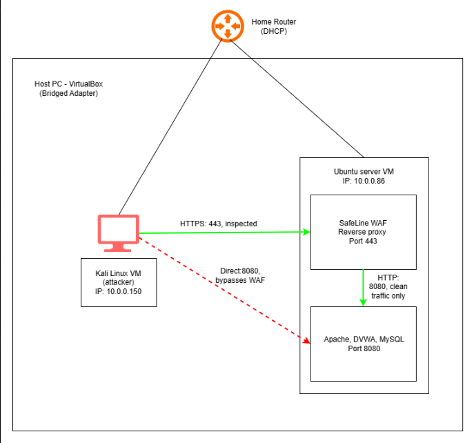

### Kali attacking virtual machine Config

First, I previously built a Kali Linux attacking machine for my Active Directory Homelab (see here: https://github.com/anthfish/active-directory-homelab), and I thought if it was possible to re-use it, and, if I do use this, will there be any kind of interference between this homelab and my AD homelab. I determined that this machine does not have project-specific data, so it was fine to go ahead and re-use it for this project without making any additional configurations.

### Ubuntu Server virtual machine setup

The 2nd machine for this homelab would be a brand new Ubuntu server from scratch. For this homelab, I used version 26.04.1 with the following settings:

- Name: UbuntuServer
- Type: Linux
- Version: Ubuntu 64-bit
- Memory: 2048MB (2GB)
- Hard Disk: 20GB
- I then followed the on-screen instructions for installation.

The reason for setting up this Ubuntu server but not fully configuring it at this point was to provide myself with a working VM to connect it with the Kali attacking machine, and attach them to the same network, or my home LAN. I did this by changing the adapter mode in the settings of both machines to a “bridged network”.

### Bridged Networking Config

Bridged networking would be the best option. With VirtualBox, the program will install a driver, known as a “net filter driver”, on my host machine, that allows for traffic to open up and with the adapter mode changed to bridged networking, my Kali VM and Ubuntu VM can grab an IP address from my home router’s internal DHCP server (which is just software installed on the router itself, as opposed to a physical server infrastructure) and appear on my home Local Area Network (LAN). So, other devices on my home LAN can see my Kali and Ubuntu VMs.

- Note: “net tools” was installed in a later step. One of the components of net tools is `ifconfig`, which I’ll use to confirm the IP addresses once it’s installed.

### Ubuntu Server Config

1. In the command line terminal, I first checked to see if there are any outstanding updates available by entering `sudo apt-get update && sudo apt-get upgrade -y`. Even though I just downloaded the Ubuntu os moments before, I’m trying to make it a habit to enter that command everytime I startup my Ubuntu VM to ensure any old bugs or vulnerabilities are corrected before beginning work.
2. Prompted net tools installation (so I can use `ifconfig` to confirm the IP address assignment later).
3. Prompted OpenSSL installation, so I can do a self-signed certificate later.
4. Next, I installed and configured the LAMP web development stack. LAMP is an acronym for Linux, the underlying operating system used to run applications; Apache, the web server that will host the DVWA; MySQL, the database that stores information in a format that is easy to recall, and that will be used to store user IDs and respective passwords; and PHP, a programming language that does server-side scripting, which helps generate web content on a server before sending it a client’s web browser.
    - Why LAMP stack specifically? It provides a simple architecture and is beginner-friendly, falling in line with my overall goal here to grow my technical expertise and familiarity, and to understand basic mechanics of how everything in this project works together.
5. Next, I begin setting up Damn Vulnerable Web Application (DVWA) by cloning it from https://github.com/digininja/DVWA.git. (Note: DVWA will be onboarded in a later step, so just setting the basics is the goal in this step).
    - DVWA is a software program hosted on a web server and accessed via a web browser that is intentionally built with many vulnerabilities and a weak security infrastructure, making it easy to attack, to educate curious users about how common web attacks are performed.
    - While it is nice to see something like this set up for educational purposes, a red flag is immediately thrown up here. The facts are 1) every public website is a target 2) there are bad actors in the world and 3) we cannot control who accesses a public-facing webpage. If a public-facing webpage is built with weak security infrastructure, it’s ripe for any bad actor lurking for easy wins. So,the DVWA github page issues a stern warning to users to “not upload it to your hosting provider's public html folder or any Internet facing servers” (https://github.com/digininja/DVWA). It suggests instead to use a virtualization program, like VirtualBox, and setting the networking adapter mode to NAT networking.
        - Note: I’m aware the instructions in the guide say to use “bridged networking” instead of NAT networking. The drawback to using bridged networking here is that, since other devices on my personal LAN can see my Kali and Ubuntu VMs, if one of those devices is compromised, an attacker can gain access to my two VMs here.
    - Set file permissions to, first, change ownership of the DVWA file applying same ownership of files within the www-data directory, then changing file permissions to 755, so the file owner (myself) can read, write, and execute file permissions, while the group and others can read and execute.
    - Next, I configured the DVWA database (I think this just opens the option), then created a new database and user in MySQL.
    - Initialized DVWA by entering `http://<Ubuntu IP>/DVWA/setup.php`
6. Next, I changed the DVWA default listening port from port 80 to 8080 because port 8080 will be set up as a “back door” during the SafeLine configuration part (see below) to avoid any port conflicts, which could return an error.

    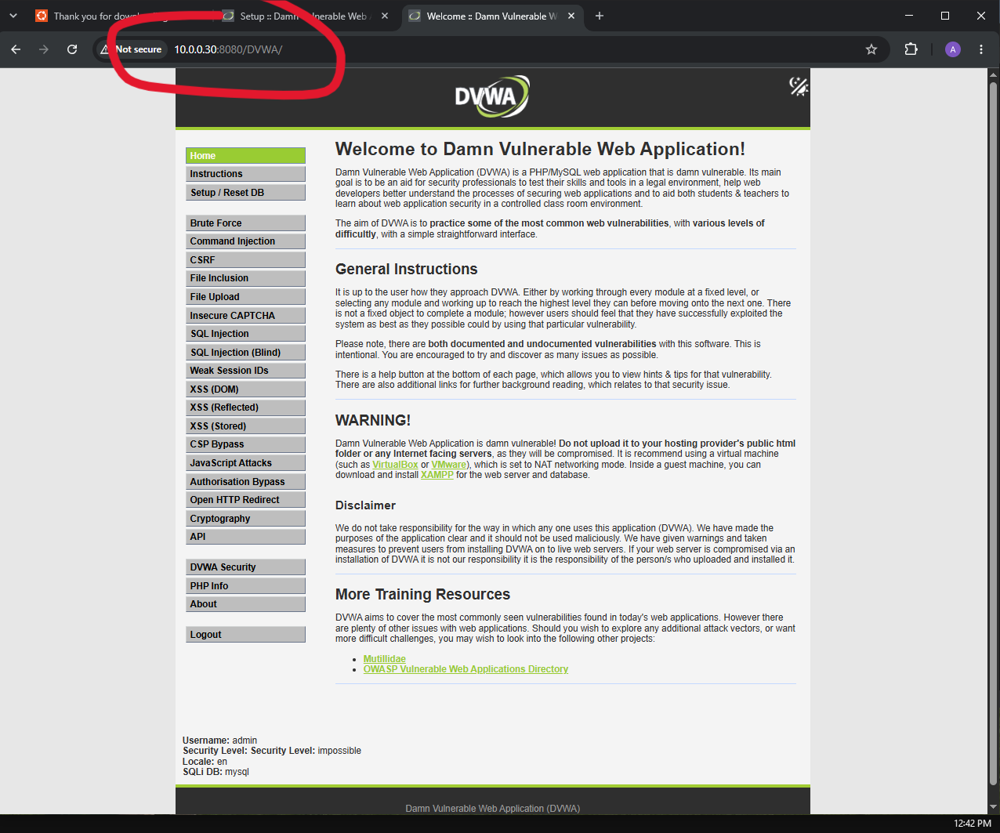

7. Next, I added 3 users as custom data to DVWA via MySQL in a table format. These entries will help me demonstrate the SQL injection attack shortly.

## DNS Resolution Setup

The goal here is to use and edit the hosts file on Linux, `/etc/hosts`, to redirect the local Ubuntu server to the local URL.

- I opened the file with `sudo nano /etc/hosts`, then edited it by adding `<Ubuntu IP> dvwa.local`
- I confirmed the change was successful by entering `http://dvwa.local:8080/DVWA` in the browser on the Kali machine, and was able to access the DVWA app.
- Source: https://linuxhandbook.com/etc-hosts-file/

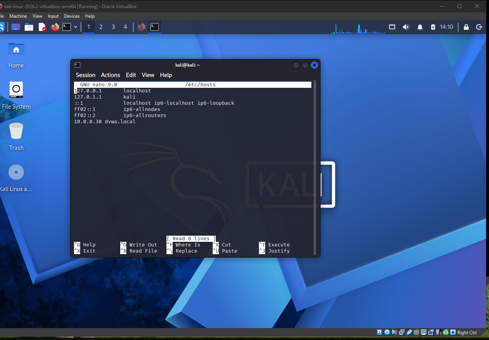

## Creating a Self-Signed SSL Certificate

- Doing a self-signed certificate rather than going through a Certificate Authority (CA).
- The reason: the foundation to having secure and encrypted communication between parties (people, websites, devices) over the Internet is trust, and to establish that trust, the participants need to prove they are who they say they are. Somebody could misrepresent myself, and somebody could misrepresent the other party– it’s a door that swings both ways. So, there has to be a layer of neutrality, and by adding a third-party that can validate and verify the identities and bind them to those correct identities establishes that foundational trust, which is why we get digital certificates to be issued by Certificate Authorities. The thing is, I’m the only one in my homelab environment using these machines. In this case, it makes sense for me to issue and manage my own certificate. Plus, I still get the benefit of secure, encrypted communication (HTTPS) within my environment.
- I created two files:
    - `.key` (where the private key will live - generated by RSA 2048 bit.)
    - `.crt` (where the certificate will live)
- Then, the two files will be imported during the SafeLine configuration phase via Ubuntu CLI (see below).

## Installing and Configuring SafeLine WAF

In this homelab, the Safeline WAF (explained below) will sit in between my home LAN and the DVWA.

And the brand of choice for a WAF this homelab is Safeline.

- **What?** “CyberServal SafeLine is a self-hosted WAF built on Nginx (a high performance, open-source web server, reverse proxy, content cache, and load balancer). It sits in front of your application (the DVWA that is displayed as a web page) as an HTTP/HTTPS reverse proxy, inspects inbound traffic with intelligent semantic analysis, drops malicious requests, and forwards only clean traffic to the origin” (source: https://www.sitepoint.com/safeline-waf-deployment-tutorial/)
    - Essentially, no clients can communicate directly with the web server.
    - How it plays out: In this case, the Kali attacking VM (the client) first sends a request to the server, which is intercepted by the reverse proxy (SafeLine) → Safeline determines whether it’ll block it or forward it to the server → if clean, request is forwarded to server → server responds through the firewall/proxy → reverse proxy sends the response to the client.
- **Why?** Safeline is “production-ready”, meaning it’s ready to go out of the box. It’s already programmed with known common web attacks and their patterns, so the setup to protect our DVWA webpage is minimal, and that falls in line with my current focus with gaining basic technical expertise early on in my career.

Completed install using SafeLine’s instructions using their automatic install method by entering the command in Ubuntu CLI:

```bash
bash -c "$(curl -fsSLk https://waf.chaitin.com/release/latest/manager.sh)" -- --en
```

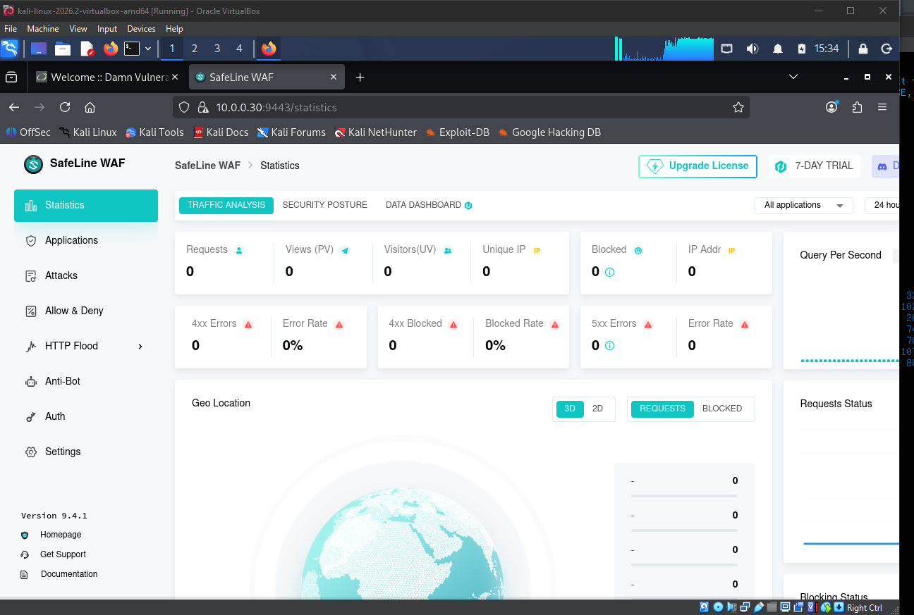

Next, I imported the .crt and .key files created with the SSL certificate via Ubuntu CLI.

Next, DVWA is onboarded by using the SafeLine WAF interface

- `www.dvwa.local` DNS name added
- Set the Backend URL to `http://<10.0.0.86>:8080`
- Deleted port 80 and only left port 443
    - SafeLine will only use port 443 HTTPS for communication; this is like a front door. Note: the port 8080 Apache is listening in on, which I changed in the configuration files when installing and configuring DVWA, would be like a back door. By deleting port 80, the way for traffic (my Kali attacking VM in this homelab) to reach the DVWA site, enters through port 443 by default. But port 8080 is still open and reachable from my network, and an attacker can bypass the WAF that listens in on port 443 completely.
- Added the domain name for the Virtual Host: `dvwa-waf.local`
- Attached the SSL certificate (created in the previous step) to get the WAF to serve HTTPS.

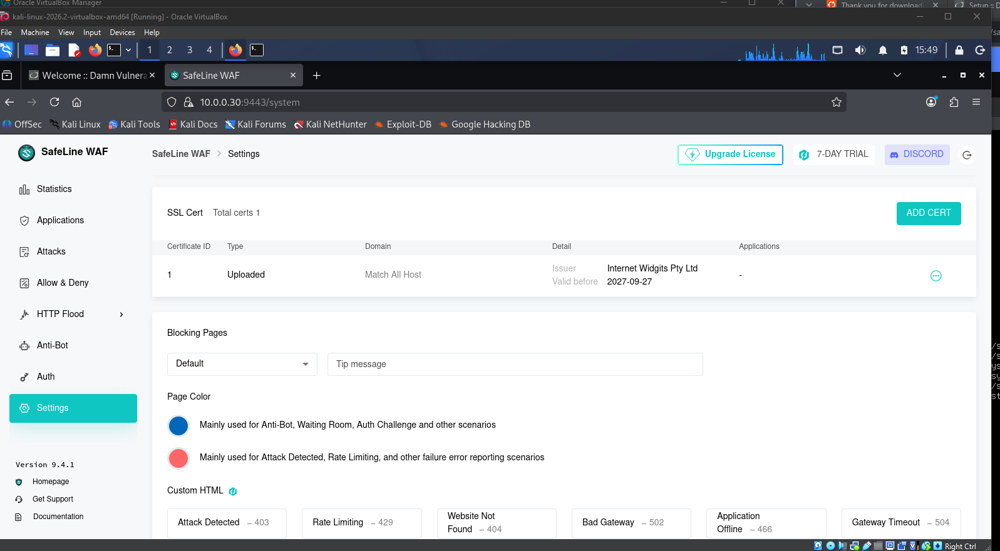

Now, everything is ready to perform the attack simulation.

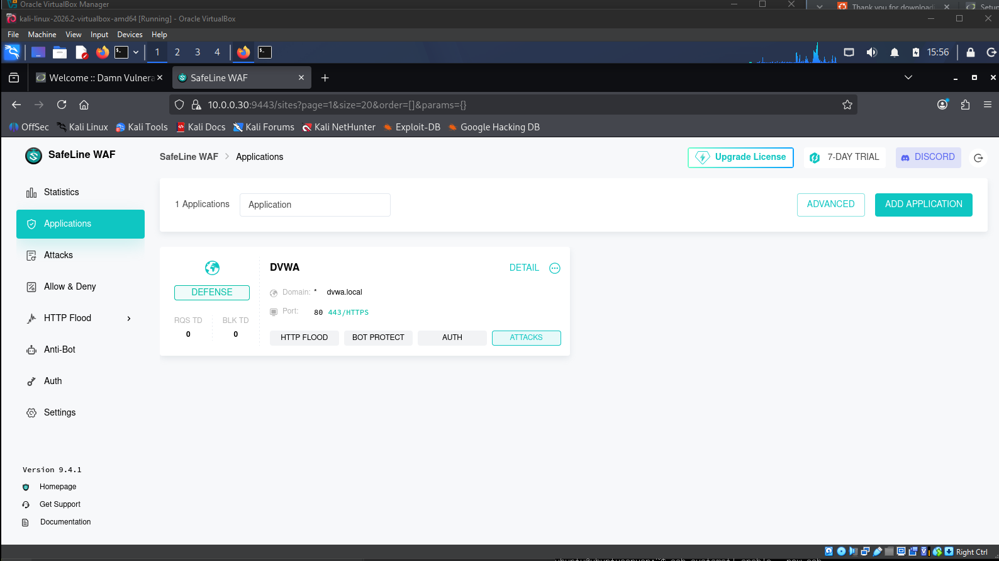

## Attack Simulation

### SQL Injection

For the SQLi attack from the Kali Linux VM, the first step was to set the DVWA security level to “low”. The default username is “admin”, and the default password is “password”.

- I submitted classic SQLi payloads like `admin'`, `'1'`, and `1'` into the “User ID” field in the “SQL injection” module. I then entered them on three separate attempts. After entering each attempt, I was immediately met with a big red page and shown “Access Forbidden”. This shows me that the SafeLine WAF was active.

    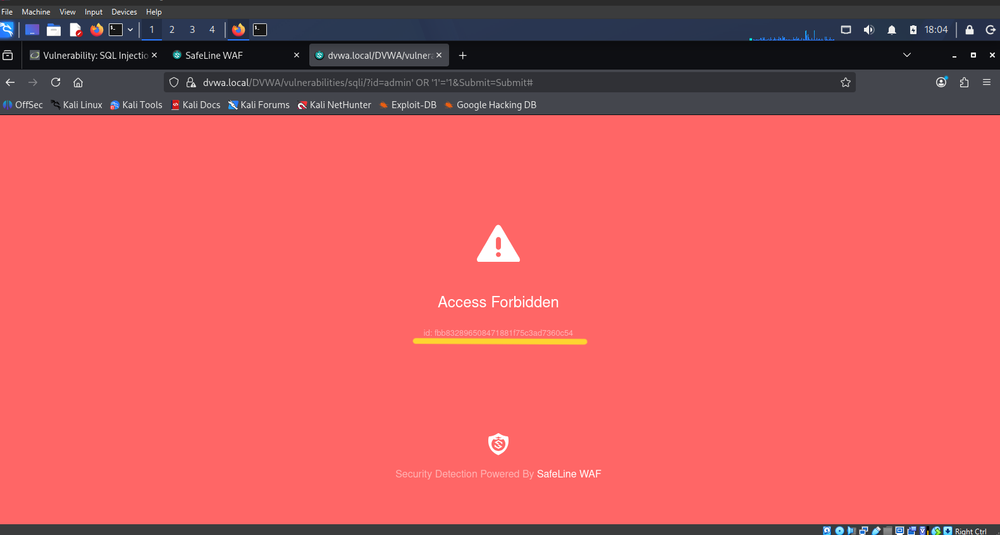

- Here, and upon some research, I learned that inputs like `admin'` or `'1'` or `1'` are “quote-injection probes”, or typical login tricks used on SQL databases. What SafeLine was doing here was it inspected each attempt, or each request, and used it for pattern recognition, which is its semantic analysis system. The split second it detects that pattern, it drops those requests, but allows me, the user, to return to the webpage.
- Along with the blocked access message, I’m also given an identification number, which I used when inspecting the WAF logs and cross-referenced the identification number. I can confirm that I used this identification number to reference on the backend when I reviewed SafeLine’s logs to confirm and track and that it was successfully blocked.

    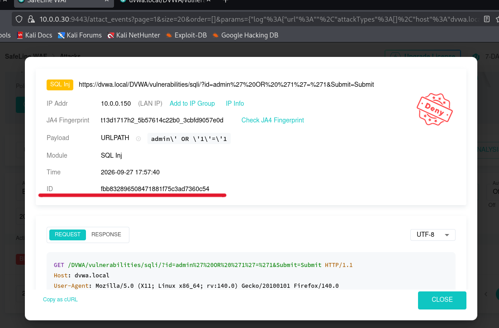

### Rate Limiting

The next attack to test out was Rate Limiting.

- First, I turned on the “Basic Access Limit” feature under the “HTTP Flood” menu option, then activated rules so that 3 requests within 10 seconds will be automatically blocked for 5 minutes.

    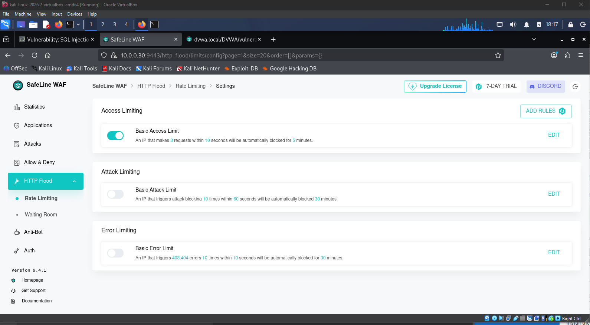

- Once those restrictions were set, I went back to the DVWA homepage and clicked three different menu options at random in under 10 seconds.
    - Each click represents a request, so when SafeLine detects this rule has been violated, a mechanism is triggered and blocks my access to the web page is, stopping me dead in my tracks for 5 minutes (although I am not told for how long on the frontend, it’s been configured on the backend).

    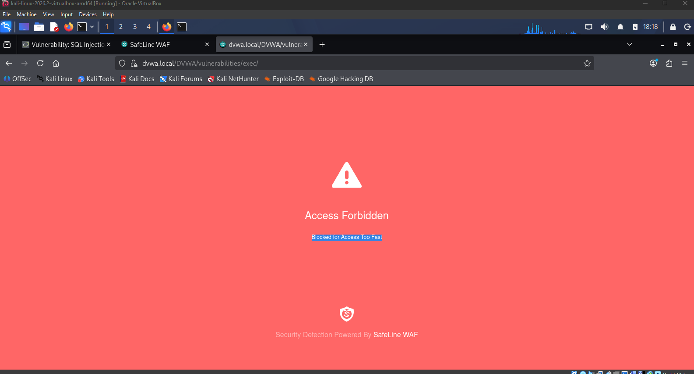

- I then verified that the attack was stopped successfully by viewing the log entry in “Rate Limiting”. The log entry shows the IP address from the attacking machine, or my Kali Linux machine (10.0.0.150), the application targeted (DVWA), the reason for the block, how many blocks were made from that same IP address, as well as a timestamp.

    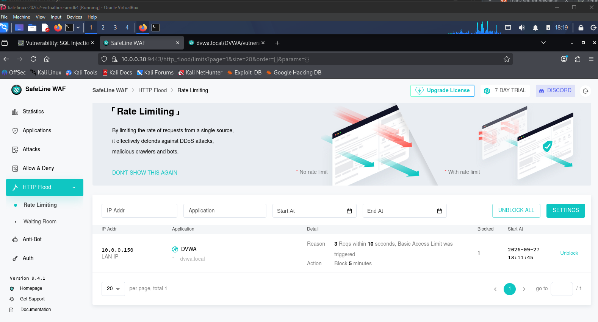

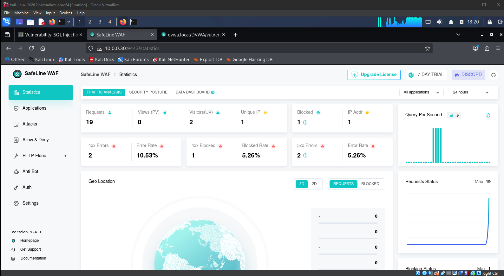

## Conclusion

In conclusion, I successfully accomplished my goal to get familiar with the mechanics, as well as the setup and configuration, of a WAF in a homelab environment, by testing out a couple of common web attacks.

One thing I now understand that I didn’t before is seeing the difference between how a request gets blocked versus how a lockout happens. During the SQLi test, once the semantics analysis system was triggered, I was allowed to return to the login page. But, with the Rate Limiting test, I was essentially locked out for 5 minutes and couldn’t access the webpage.

One thing I’d do differently next time is set up the networking mode as a NAT network rather than as a Bridged Network. While the Bridged Networking option was fine for this homelab, there’s still a risk that another device on my personal LAN can be compromised and an attacker can gain access to devices on this homelab. If it was a NAT network, my two VMs would be sitting behind my host machine, isolated from my personal LAN, almost like in a private room. So, devices on my personal LAN wouldn’t be able to see my Kali and Ubuntu VMs.
